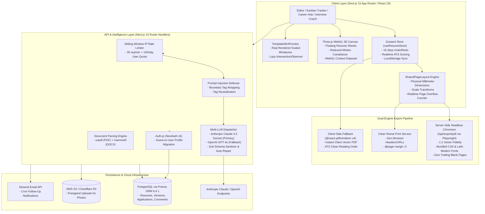

# ResumeForge Architecture & Technical Deep-Dive

## 1. System Overview

**ResumeForge** is an enterprise-grade AI Career Copilot built with Next.js 15 (App Router), TypeScript, Tailwind CSS, Zustand, Three.js, Prisma ORM, and Multi-LLM orchestration (Anthropic Claude + OpenAI).

Unlike traditional resume builders that output flattened canvas screenshots or static templates, ResumeForge is built around three core engineering pillars:
1. **1:1 WYSIWYG Vector PDF Generation**: Eliminates the preview-vs-PDF gap. What you see in the editor is mathematically identical to the downloaded PDF down to millimeter accuracy, powered by server-side headless Chromium with client-side `@react-pdf/renderer` vector fallback.
2. **Zero-Gap Physical Pagination**: Strict millimeter layout (A4: 210mm × 297mm, US Letter: 215.9mm × 279.4mm) with dynamic threshold calculation guaranteeing zero trailing blank pages.
3. **Hardened Multi-LLM Provider Engine**: Type-safe streaming and JSON schema enforcement with Zod, sliding-window rate limiting, and prompt-injection defenses.
4. **Full Career Lifecycle Management**: From JD matching and STAR interview prep to GitHub repository ingestion and salary negotiation scripts.

---

## 2. Complete Architecture Diagram

---

## 3. Core Subsystems

### 3.1. 1:1 WYSIWYG Rendering Pipeline (`src/components/preview/SharedPageLayout.tsx` & `src/lib/export/serverPdfRenderer.ts`)
* **Problem**: Traditional resume builders use one layout engine for previewing on the web (HTML/CSS) and a completely different renderer (Canvas or low-level PDF primitives) for export. This introduces font metric variances, line-wrapping discrepancies, dangling headers, and blank trailing pages.
* **Solution**:
  - `SharedPageLayout` serves as the single source of truth for both live preview and server-side PDF generation.
  - Dimensions are locked to physical millimeter units (`210mm` for A4, `215.9mm` for US Letter).
  - Headless Chromium (Playwright) boots in a headless context, injects the exact compiled Tailwind stylesheet and system serif fonts, waits for `document.fonts.ready` and all images, and outputs a pure vector PDF.
  - `@page { margin: 0 }` is enforced, allowing the internal padding of the resume to control page margins with zero printer-driver offsets.
  - Dynamic page height detection ensures that content only breaks across pages when it genuinely overflows beyond a 4px hysteresis buffer.

### 3.2. Classic Professional LaTeX-Grade Template (`src/templates/ClassicProfessional.tsx`)
* **Design Philosophy**: Built to match academic and executive CV standards:
  - Small-caps header styling with sub-headings (`font-variant: small-caps`).
  - Horizontal rules separating sections (`border-b border-black`).
  - Compact top-right photograph (`32mm` width) without breaking layout flow.
  - Left-aligned 2-column skills grid.
  - Strict hyphenation prevention (`hyphens: none`).
  - Special character preservation: `% & $ # _ { } < > " ' – — ’` and Unicode characters survive both PDF and DOCX pipelines without truncation.
* **Content Quality Linter**: Built-in AST checks in `formatUtils.ts` scan for dangling punctuation, incomplete bullet points, and trailing numbers (e.g. `"latency, 98"`), surfacing immediate warning tags in the editor.

### 3.3. Multi-LLM Provider Engine (`src/lib/ai/provider.ts`)
* **Dual-Provider Architecture**: Anthropic Claude 3.5 Sonnet serves as the primary engine for high-reasoning tasks (tailoring, interview coaching, recruiter scan simulation). OpenAI GPT-4o serves as the configurable alternative/fallback.
* **Strict Type Safety**: Every AI response is validated with Zod schemas before being returned to the client. If an LLM returns slight markdown artifacts, an automated 1-attempt repair sanitizer normalizes the payload.
* **Prompt Injection Defense**: All user-supplied resumes, job descriptions, and GitHub READMEs pass through `wrapUntrustedInput()`, which wraps content in explicit `<untrusted_tag>` boundaries and escapes nested closing tags.
* **Zero Mock Data Guarantee**: If an API key is unconfigured, the system returns typed `MissingAPIKeyError` (HTTP 401 with `isMissingKey: true`) rather than generating misleading synthetic dummy data.

### 3.4. State Management & Offline Guest Mode (`src/lib/store/useResumeStore.ts`)
* **Dual-Mode Persistence**: Unauthenticated users can build, customize, and export resumes immediately via localStorage-backed Zustand state.
* **1-Click Account Migration**: Upon signing in with Auth.js (OAuth or Magic Link), `/api/auth/migrate-guest` automatically transfers the local resume and application history into PostgreSQL under the user's permanent profile.
* **Deep History**: The Zustand store maintains a 15-state undo/redo stack, tracking all mutations, custom section insertions, and styling modifications.

### 3.5. Security & Abuse Prevention (`src/lib/ai/rateLimiter.ts`)
* **IP Sliding Window**: Enforces a maximum of 30 requests per minute per IP address.
* **User Daily Quota**: Enforces a 100-request daily quota for authenticated accounts tracked directly in the PostgreSQL `User` table.
* **Input Size Validation**: Rejects payloads exceeding 50,000 characters to prevent prompt inflation and token exhaustion attacks.
* **Cron Authentication**: The reminder automation endpoint (`/api/reminders/cron`) requires a cryptographically strong `Bearer ${CRON_SECRET}` header.

### 3.6. WebGL 3D Visualization (`src/components/3d/`)
* **HeroScene**: Particle field with interactive mouse parallax and floating 3D resume meshes.
* **ResumeOrbit3D**: Real-time 3D inspection allowing candidates to rotate, tilt, and examine their document with dynamic shadows and rim lighting.
* **Production Hardening**:
  - Full WebGL resource disposal on component unmount (`geometry.dispose()`, `material.dispose()`, `texture.dispose()`, `renderer.forceContextLoss()`).
  - Strict compliance with `prefers-reduced-motion` media queries.
  - Graceful CSS/SVG 3D fallback for low-power or WebGL-disabled devices.

---

## 4. Database Schema (Prisma)

The PostgreSQL schema consists of:
- **`User`**: Account identity, OAuth profiles, daily AI usage counter, and security timestamps.
- **`Account`, `Session`, `VerificationToken`**: Auth.js / NextAuth v5 standard authentication models.
- **`Resume`**: JSON resume content, theme configuration, ATS health score, public sharing token, password hash, and expiry.
- **`ResumeVersion`**: Snapshot history for A/B testing and rollbacks.
- **`Application`**: Kanban job tracker items with interview dates, salary offers, notes, and reminder flags.
- **`ResumeComment`**: Public peer & mentor feedback entries attached to specific sections.

---

## 5. Deployment Guide

### Vercel / Railway / Docker
1. Set environment variables from `.env.example`.
2. Connect a PostgreSQL instance (e.g. Neon, Supabase, or AWS RDS).
3. Run migrations: `npx prisma db push`.
4. Deploy the Next.js app: `npm run build && npm start`.
